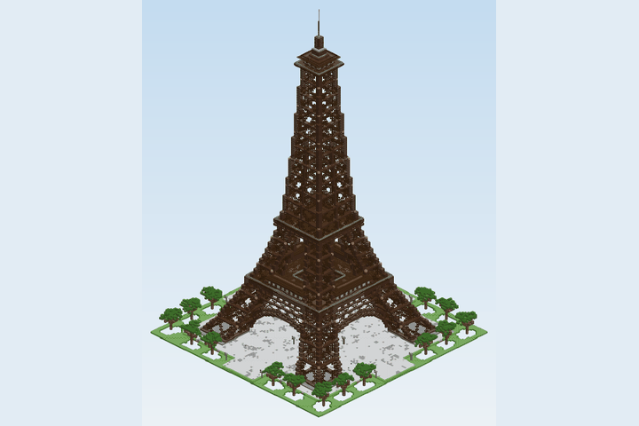
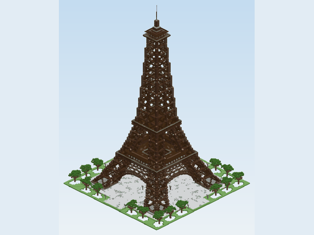
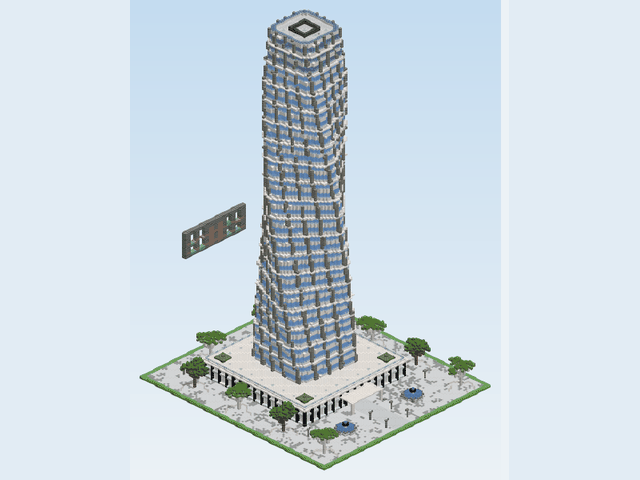
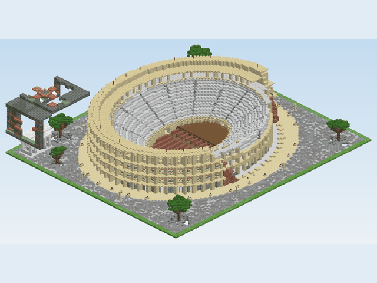
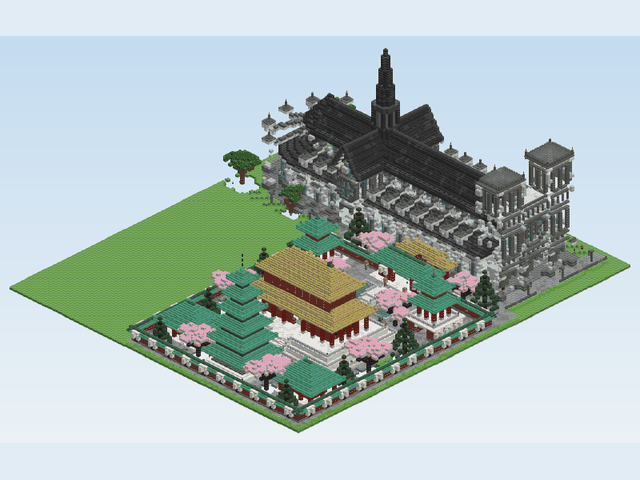
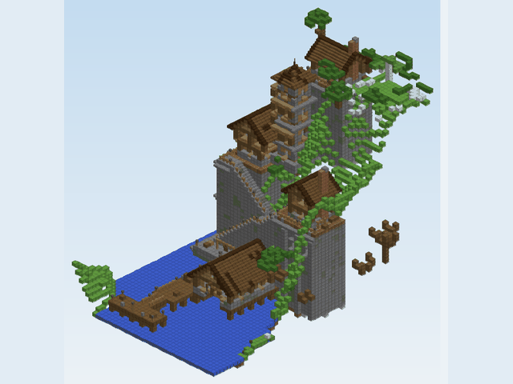
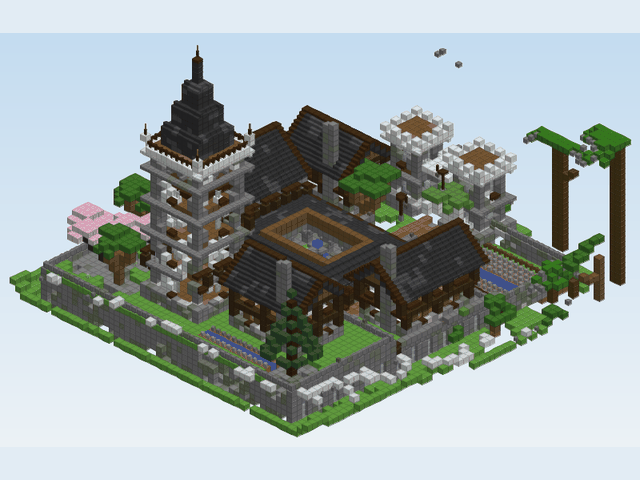
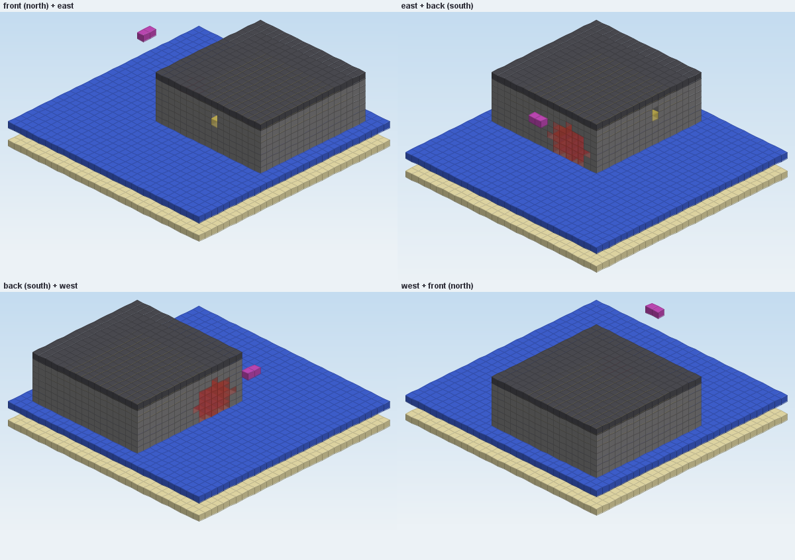
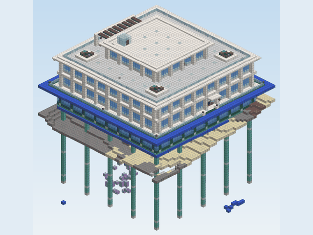
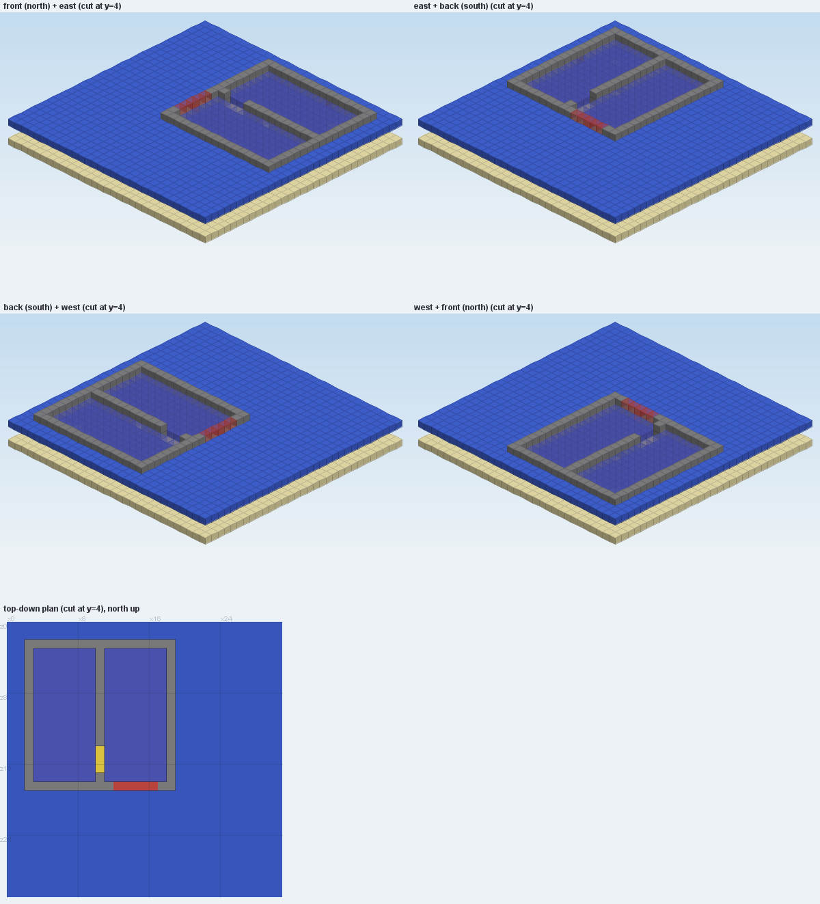

<div align="center">

# 🏛️ Claude Architect

### An AI master builder for your Minecraft server.<br>Talk to it in chat. Watch it design, build, repair and renovate anything.

[](https://papermc.io)
[](https://adoptium.net)
[](https://github.com/Shengboj0324/Minecraft-Companion/actions/workflows/build.yml)
[](LICENSE)
[](https://github.com/Shengboj0324/Minecraft-Companion/releases/latest)



*Every build above was designed by the Architect and built on a live Paper 26.3 server.<br>These are the images Claude itself looks at while it designs.*

</div>

---

> **"Architect, build the Eiffel Tower at 2:3 scale right here."**
> Six minutes later, a 220-block tower with curved lattice legs, three platforms and a tree-lined plaza stands in front of you. It was placed in **6 seconds** while the server stayed at a steady **20 TPS**.

Claude Architect is a [Paper](https://papermc.io) plugin that puts a player-like builder on your server. Ask it for a cottage, a cathedral, a twisting skyscraper, a real-world landmark, or *"fix and renovate my blown-up base"*. It plans the build, **looks at renders of its own work, critiques it, fixes it, and only builds when the design passes a quality gate**. Then you watch it build block by block.

## ✨ Highlights

| | |
|---|---|
| 💬 **Just talk to it** | Start a chat message with *"Architect"*. It follows you, answers questions, and builds what you describe. It runs on Claude, Anthropic's AI. |
| 👁️ **It actually sees** | Claude gets rendered images of every build from four corners, a top-down plan and cutaway floor slices, plus a structural analysis of floors, rooms, damage and dark spots. |
| 🗼 **Landmarks and mega builds** | It knows the real proportions of famous buildings and has geometry tools for domes, lofts, trusses and twisting towers. Builds of a million blocks are placed tile by tile without lag. |
| 🛠️ **Renovates existing builds** | Point it at a base and say what you want. It reads the build, finds blast holes, flooding and dark spots, then repairs, refurnishes, lights it and adds elevators. Only the changes are placed. |
| 🏔️ **Builds on real terrain** | Hills, rivers, coasts, forests. It surveys the land and either levels a pad with smooth edges or builds into the terrain with terraces, stilts and piers. |
| 🛡️ **Safe for multiplayer** | It never touches chests, signs or item frames, respects WorldGuard and GriefPrevention claims, logs to CoreProtect, has undo that survives restarts, daily quotas per player, and slows down automatically when the server lags. |

## 🎬 See it in action

<table>
<tr>
<td width="50%"><br><b>Eiffel Tower, 2:3 scale</b>: 51,892 blocks, quality 85</td>
<td width="50%"><br><b>"A 200-block twisting supertall with a glass curtain wall"</b>: 87,341 blocks, quality 80</td>
</tr>
<tr>
<td><br><b>Colosseum, 1:2 scale</b>: three arcaded storeys, the ruined south side, the Arch of Constantine. Quality 81</td>
<td><br><b>Notre-Dame (93) and a Chinese temple (95)</b>: rose windows and flying buttresses beside a pagoda and koi pond</td>
</tr>
<tr>
<td><br><b>Fishing village on a real river cliff</b>: quay, boathouse, stairs up the cliff. Natural terrain mode, quality 82</td>
<td><br><b>Terraced hillside monastery</b>: three terraces cut into a slope, bell tower on the high ground. Quality 95</td>
</tr>
</table>

## 🛠️ "Fix and reinvent this base"

We built a 41 × 41 multi-floor ocean base with a dry glass lab below sea level and chests full of loot. Then we **blew it up with 12 TNT**. Then we said one sentence in chat:

> *"Architect, fix and reinvent this base: renovate, add walls, floors, lighting, furniture, interior walls, elevators and details at the bottom"*

<table>
<tr>
<td width="50%"><br><b>What it sees first</b>: blast holes (red), loose fragments (magenta), seawater inside (blue), spots where mobs can spawn (yellow)</td>
<td width="50%"><br><b>"Tidewatch Pavilion"</b>, what it built: a fin facade, a waterline deck, a rebuilt penthouse, two elevators, furnished rooms</td>
</tr>
</table>

| Measured on a live server | Result |
|---|---|
| Quality score | **56 → 92** |
| Blocks changed | 11,587, placed in about 1 s |
| Server performance | **20.0 TPS** throughout, worst tick 24 ms |
| Chests (diamonds, elytra, netherite) | **all intact**, contents unchanged |
| Water | drained and sealed; the final check found no leaks |
| Dark spots where mobs spawn | 2,535 → **0** |

It found the holes, pumped out the lab, sealed the shell, then redesigned the facade and the interiors. After building, it **re-read the whole base and checked it again**: no leaks, no dark spots, every protected block intact.



*A cutaway slice: how Claude looks inside a floor to plan rooms, walls and furniture.*

## 📊 Tested on a live Paper 26.3 server

Every build was designed by Claude Opus 5.5 and placed on Paper 26.3 at full speed. The quality score comes from the plugin's own critic, which checks materials, detail, facade depth, openings, roof, skyline, lighting and structure. **80 is required to build.**

| Request | Design time | Quality | Blocks | Placed in | Server |
|---|---|---|---|---|---|
| Eiffel Tower at 2:3 scale | 6 min | **85** | 51,892 | 6 s | 20 TPS |
| 200-block twisting supertall, glass curtain wall | 3.4 min | **80** | 87,341 | 11 s | 20 TPS |
| Colosseum at 1:2 scale | 7.7 min | **81** | 72,558 | 9 s | 20 TPS |
| Gothic cathedral like Notre-Dame | 8.2 min | **93** | 38,736 | 4 s | 20 TPS |
| Big Chinese temple with details | ~8 min | **95** | 34,511 | 4 s | 20 TPS |
| Fishing village on a river cliff *(natural terrain)* | 8.8 min | **82** | 15,927 | 2 s | 20 TPS |
| Cottage on a forest slope *(level + graded)* | 1.4 min | **94** | 2,224 | <1 s | 20 TPS |
| Monastery stepping down a hillside | 3.6 min | **95** | 21,297 | 3 s | 20 TPS |
| Renovate a TNT-damaged ocean base | 10 min | **56 → 92** | 11,587 changes | ~1 s | 20 TPS |

Design time is how long Claude spends planning, building, looking and refining. Placement is spread across ticks, and the worst single tick we measured during any build was 89 ms.

## 🚀 Quick start

1. Run a **Paper 26.3+** server on **Java 25**.
2. Download `ClaudeArchitect-1.1.0.jar` from the **[latest release](https://github.com/Shengboj0324/Minecraft-Companion/releases/latest)** and drop it into `plugins/`.
3. Start the server, then put your [Claude API key](https://platform.claude.com) in `plugins/ClaudeArchitect/config.yml` under `anthropic.api-key`.
4. Run `/architect reload`, then in game:

```
Architect, build me a gothic cathedral with flying buttresses
Architect, follow me
Architect, fix and renovate this base and add an elevator      (look at the build)
```

Without an API key it still works: 12 curated master templates, `/architect repair` and the elevator pads need no AI.

📖 **[Full guide](docs/GUIDE.md)**: install, permissions, every command and config option, how it works.

## 🎮 Commands

| Command | What it does |
|---|---|
| *"Architect, …"* in chat | Talk to it: build, renovate, follow, stay, undo, ask questions |
| `/architect build <description>` | Design and build something new in front of you |
| `/architect renovate <what to do>` | Renovate the build you're looking at (or your `pos1`/`pos2` selection) |
| `/architect repair` | Free quick fix: patch holes, drain water, light dark spots (no AI) |
| `/architect inspect` | What it sees in a build: floors, rooms, damage, flooding, dark spots |
| `/architect undo` · `cancel` · `status` · `rate <1-5>` | Manage your builds; 4–5 star ratings teach it your taste |
| `/architect template <name>` | Instant master designs: castle, cathedral, temple, village and more |

Permissions: `architect.use`, `architect.renovate`, `architect.elevator.use`, `architect.unlimited`, `architect.admin`. See the [guide](docs/GUIDE.md#permissions).

## 🧠 How it works

```
 "Architect, build ..."  ──►  chat agent (Claude)  ──►  design studio (Claude Opus 5.5, tool use)
                                                          │  set_plan · build(ops) · use_template · lookup_landmark
                                                          │  view_build / render_views  ◄── rendered PNGs of its own work
                                                          │  inspect_structure / survey_terrain  ◄── analysis of the world
                                                          ▼
                                                quality gate (critic score ≥ 80, no floating blocks)
                                                          ▼
                       placement engine: tile by tile, async chunk loading, time-budgeted per tick,
                       undo journal, protection checks, CoreProtect logging, physics-free (nothing floods)
                                                          ▼
                       the Architect NPC (a Paper Mannequin) walks over and animates the build
```

- **Voxel design model with 40+ building ops**: roofs, arches, windows, modules (houses, towers, gatehouses, pagodas), large geometry (revolve, loft, polygon, implicit shapes, trusses), furniture, elevators and repairs.
- **A real visual feedback loop**: a headless renderer draws isometric views, plans and cutaways. Claude critiques them like a judge at a build contest.
- **Structure analysis**: floors, rooms, circulation, blast holes (it tells doors and windows from damage), flooding, light levels and loose fragments.
- **No client mods, no other plugins required.** It's 100% Paper API, and the Claude SDK is bundled in the jar.

## 💰 What it costs

It uses your Claude API key. These are measured token counts, priced at Claude Opus 5.5 API rates:

| Job | Approximate cost |
|---|---|
| Cottage | ~$0.30 |
| Eiffel Tower / cathedral | ~$1.20–1.60 |
| Big renovation (the ocean base) | ~$2.40 |
| Chatting, templates, `repair`, undo | ~free |

Switch to `claude-sonnet-5-5` in the config to roughly halve that, and set daily per-player limits on public servers.

## ⚠️ Honest limitations

- Designs take **1–10 minutes**; the Architect thinks before it builds.
- It needs a **Claude API key** for custom designs, and that costs money (see above).
- Quality is high but not perfect. Occasionally a build has a stray block or an awkward detail. `/architect undo` restores everything exactly.
- Land protection is enforced through WorldGuard and GriefPrevention hooks and a generic event check. We haven't yet tested it alongside every protection plugin; do a short trial on your server first.
- One builder NPC per server; builds queue.

## ❓ FAQ

**Does it need client mods?** No. Players use vanilla Minecraft Java 26.3.

**Will it lag my server?** Placement is time-budgeted per tick and slows down automatically when MSPT rises. In every test the server stayed at 20 TPS.

**Can it destroy my stuff?** It never changes containers, signs, banners or item-frame mounts, and only builds where the requesting player could build. Everything is undoable, also after a restart.

**Does it work in normal survival worlds?** Yes: hills, rivers, oceans and forests, in both levelled and natural-terrain modes.

**Can I use it without paying?** Templates, `/architect repair`, undo and elevator pads work without an API key.

## 🧪 Build from source

```bash
./gradlew build    # Java 25. Runs the 34 tests and writes build/libs/ClaudeArchitect-<version>.jar
```

## 📜 License and disclaimer

[MIT](LICENSE). Made by [@Shengboj0324](https://github.com/Shengboj0324).

This is an **unofficial** fan project. It is not affiliated with or endorsed by Mojang, Microsoft or Anthropic. Minecraft is a trademark of Mojang. Claude is a trademark of Anthropic. The plugin ships no Minecraft assets; renders use colours from a resource pack or client jar that the server admin provides, or a built-in palette.
